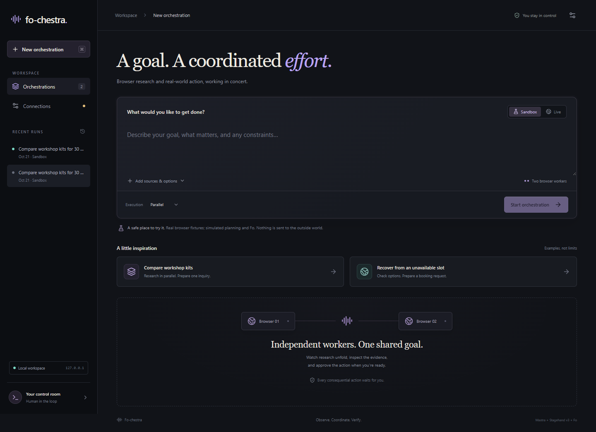

# Fo-chestra

Fo-chestra coordinates browser research, exact human approval and Fo tasks in one local workspace. Two isolated browser workers collect source evidence; a Mastra workflow pauses for review of a specific action; backup research can continue while Fo works. The interface keeps browser observations, model recommendations, provider reports and independently checked outcomes distinct.

**Status: v0.1.0 hackathon prototype; work in progress.** The working app was built during the October 17–19, 2026 Wajo AI × Anthropic event, with no earlier working app. The event submission was completed on October 20. See the [public demo on X](https://x.com/nakulsolai_wisc/status/2112237731963154724), [v0.1.0 release](https://github.com/nakulSolai/Fo-chestra/releases/tag/v0.1.0) and [submission record](docs/SUBMISSION.md).



October 21 sandbox capture, using fictional local fixtures. [Inspect a completed sandbox run](docs/assets/sandbox-completed.png).

## Try the sandbox

The default sandbox requires **no API key** and performs no external action. It uses real Chrome/Stagehand navigation and screenshots against fictional local vendor pages, with deterministic planning and a simulated Fo service. The server binds to `127.0.0.1`.

Use Node.js 22.13 or newer and an existing Chrome/Edge installation. The event build was checked on Windows with Node.js 26.8.1; dependencies are locked in `package-lock.json`. No additional browser download, Docker or cloud browser is required for that path.

```sh
npm ci
npm run build
npm run dev
```

Open <http://127.0.0.1:4318>. Keep **Sandbox** and **Parallel**, start an example, inspect the browser evidence, then reject or approve the simulated inquiry. **Approve simulation** never contacts Fo. In parallel mode, a backup browser starts alongside the simulated service; sequential mode runs the same work serially. The default limit is two concurrent browser workers.

A clean clone starts without private run history, email receipts or recordings. The demo's historical real email segment is evidence from the original local workspace, not bundled application data; its saved-result control is unavailable without suitable local history. The recording view at `?record=1` also contains a labeled snapshot of the controlled benchmark. Follow the [demo guide](docs/DEMO.md) to reproduce the sandbox flow.

The server serves the built interface: rebuild after changing `web/`, and restart after server or environment changes. A `.env` file is optional for the sandbox; copy `.env.example` only when configuring local overrides or live providers.

## What v0.1.0 demonstrates

| Capability | Evidence and boundary |
| --- | --- |
| Isolated browser research | Real installed Chrome, fixture navigation, screenshots and bounded cancellation/cleanup; arbitrary production websites are outside this evidence. |
| Exact human authorization | Payload fingerprints, persisted dispatch claims, approval rejection/tampering tests and workflow suspension/resumption. |
| Browser/Fo overlap | Demonstrated with real fixture browsers and simulated Fo waits. |
| Live model research | Actual Sonnet/Haiku planning, public-page extraction and evidence review during the event. |
| Live Fo email | One approved dispatch and one independently observed delivery; added footer text and HTML failed the approved requirements, so the overall outcome remains **partial**. |
| Controlled benchmark | Six fixture runs: median 19.107 s sequential and 11.936 s parallel; one parallel trial was slower. This small simulated-Fo sample does not establish a general speedup. |

Live progress/question transitions, bookings, calls, purchases, remote idempotency, live browser/Fo overlap and production multi-user operation remain unvalidated. Gmail receipt inspection used a separate operator connector; this app does not contain a Gmail OAuth integration. Detailed dated results are in [VALIDATION.md](docs/VALIDATION.md).

## Original contribution and reused tools

Fo-chestra adds the exact-action approval ledger, cross-run spending reservations, conservative ambiguous-dispatch handling, bounded browser ownership, source correlation, coordinated Fo/browser work and independent destination/content checks. The general goal interface uses repeatable scenarios as examples.

Mastra owns agent reasoning, workflow coordination, suspension and storage. Stagehand **v3** supplies browser intelligence; Anthropic supplies model inference; the MCP SDK supplies transport/OAuth primitives; Fo/Wajo supplies the external action service. React, Hono and Vite provide the application foundations. Versions and attribution are recorded in [DEVELOPMENT.md](docs/DEVELOPMENT.md).

## Optional live setup

Copy `.env.example` to a local `.env` and set `ANTHROPIC_API_KEY` server-side. The event configuration uses `anthropic/claude-sonnet-5-5` for planning and `anthropic/claude-haiku-5-5` for browser extraction; model IDs are configurable. Account access and provider availability must be checked separately from the presence of a key.

Live research is bounded to public HTTP(S) pages. It blocks page scripts, active requests, private network addresses, sign-in, form submission, downloads and model-controlled browser actions. JavaScript-dependent or automation-blocked pages can fail visibly.

Use **Setup → Connect Fo** for the application's Wajo OAuth session. An authenticated connector in another client does not authenticate this app. Tokens stay in server memory and clear on restart; setup must discover compatible `ask_fo` and `get_fo_reply` schemas.

`FO_ENABLE_LIVE_ACTIONS` defaults to `false`. Enabling it still requires human approval bound to the exact target, payload, constraints and spending limit. Edits invalidate approval. Answers to Fo questions require their own approval. Dispatch intent is persisted before submission; uncertain acceptance is reconciled rather than automatically resubmitted. Local cancellation can stop monitoring while remote Fo work continues.

The local ledger conservatively reserves cumulative spend across runs, including uncertain submissions. It cannot independently enforce provider charges or guarantee remote exactly-once execution.

## Verify locally

```sh
npm run typecheck
npm test
npm run build
npm run test:e2e
```

Playwright Test uses the existing Chrome channel with one test worker. With the app running and no other run active, the optional sandbox checks are:

```sh
npm run smoke
npm run benchmark
```

These scripts use simulated actions and no paid inference. Benchmark output goes to ignored `.data/validation/benchmark.json`. Historical event results and later release checks have separate dates in the [validation record](docs/VALIDATION.md).

## Source map

| Path | Purpose |
| --- | --- |
| `src/planner/` | Bounded Mastra planning and typed output |
| `src/browser/` | Stagehand workers, source capture and network policy |
| `src/server/engine.ts` | Workflows, fan-out, persisted review and Fo/browser overlap |
| `src/security/` | SQLite approval ledger, fingerprints, reservations and dispatch claims |
| `src/fo/` | MCP transport, in-memory OAuth and explicit simulation |
| `src/verification/` | Independent email receipt checks and action correlation |
| `src/server/` | Loopback API, run snapshots, fictional fixtures and redacted exports |
| `web/` | Supervisor interface, evidence, timeline and approval controls |
| `tests/`, `scripts/` | Repeatable verification and local development tools |

Mastra workflow snapshots track execution; the separate action ledger authorizes external writes. Interrupted browser work is not replayed after restart. Persisted approval suspension can resume, and uncertain dispatches stay blocked from blind resubmission.

## After the hackathon

The v0.1.0 baseline preserves the submitted prototype and its measured limitations. Future work includes broader public-page coverage, live progress/reconciliation validation, repeatable independent outcome checks, larger benchmark samples and deployment hardening. Dynamic replanning and unrestricted/sign-in browser automation are proposals, not implemented features.

Credentials, private communications, databases, browser profiles, raw traces and recordings stay outside Git. Review screenshots and exports before sharing. Contributor expectations are in [AGENTS.md](AGENTS.md); the [recording notes](docs/RECORDING.md) explain the submitted video's provenance and reproduction limits.

## License

Fo-chestra's original code is available under the [MIT License](LICENSE). Third-party dependencies retain their own licenses; see the [attribution record](docs/DEVELOPMENT.md).
